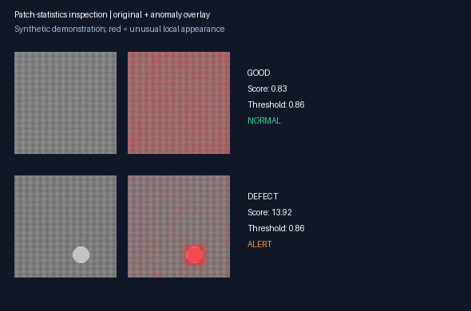

# Visual Defect Inspection

**An interpretable image-anomaly baseline by [Mahou Mehdi](https://github.com/Mahou-Mehdi).** Learn the appearance of normal textures, calibrate an alert threshold on separate normal images, then score new images and highlight unusual regions.

This is a working classical statistical computer-vision project. It does not use a neural network or pretrained weights. Its included evaluation uses **original synthetic images only**; it makes no claim of production readiness or real industrial benchmark performance.



## Features

- Procedural texture dataset generator with reproducible random seeds.
- Distinct training, threshold-calibration, and untouched test splits.
- Normal-only model fitting; no defective images are used for training or threshold selection.
- Image-level scores, thresholded alerts, and 16-by-16 spatial anomaly maps.
- Readable overlays, test-set AUROC, recall, false-alarm counts, and inference timings.
- File-hash checks for exact duplicate leakage across splits.
- Commands for training and evaluating image folders or predicting on a single image.

## Quick start

Requires Python 3.11 or newer. Run from the repository root.

```bash
python -m venv .venv
# Windows PowerShell:
.venv\Scripts\Activate.ps1
# macOS/Linux: source .venv/bin/activate
python -m pip install -r requirements.txt
python inspection.py generate --data data/synthetic --seed 42
python inspection.py train --data data/synthetic --model output/model.npz
python inspection.py evaluate --data data/synthetic --model output/model.npz --output output/evaluation
python inspection.py predict data/synthetic/test/defect/000.png --model output/model.npz --output output/overlay.png
python -m unittest discover -s tests -v
```

Open `output/evaluation/inspection-demo.png` and `output/overlay.png`. Full scores and metrics are in `output/evaluation/metrics.json`. The dataset generator refuses to overwrite a nonempty directory; reuse generated data for later training/evaluation runs, or give a fresh destination when changing the seed.

The project runs locally on CPU with NumPy and Pillow. It needs no cloud service, account, model download, or GPU. Generated datasets and model files are excluded from Git.

## Actual recorded results

The committed [metrics and per-image predictions](examples/metrics.json) were produced by executing this code with seed 42. Split sizes were **64 normal training images, 32 separate normal calibration images, and 128 test images (64 normal + 64 defective)**.

| Measure | Observed result |
|---|---:|
| Image AUROC | 1.000 |
| Detected test defects | 64 / 64 |
| Defect recall | 100% |
| False alarms on normal test images | 7 / 64 |
| Normal false-alarm rate | 10.94% |
| Threshold from normal calibration images | 0.861700 |
| Mean image inference, recorded CPU run | 1.88 ms |

The defects are deliberately conspicuous synthetic scratches and spots, making this an easy dataset. These results show that the pipeline runs and separates the generated anomalies; **they do not establish real-world quality**. The false-alarm rate is reported explicitly: a threshold chosen at the 95th calibration percentile does not guarantee a 5% false-alarm rate on future samples, especially with only 32 calibration images.

Timing includes image decoding, resizing, feature extraction, and scoring. It excludes model loading and overlay generation. It is a local single-process measurement, not a server throughput benchmark. Tested with Python 3.12, NumPy 2.4.6, and Pillow 12.3.0 on Windows. Rerunning may change timing, while fixed-seed data and score metrics should remain stable for the same numerical stack.

## Method

1. Convert each image to grayscale and resize to 128 × 128 pixels.
2. Split the image into an aligned 16 × 16 grid of 8 × 8 pixel patches.
3. For each patch, extract mean and standard deviation of intensity, absolute horizontal gradient, and absolute vertical gradient: six features total.
4. Fit a mean and diagonal standard deviation at each patch location using training normals. A 0.005 scale floor prevents division by near-zero values.
5. Score each patch with the root mean squared standardized deviation. The image score is the mean of its two highest patch scores.
6. Choose the image alert threshold from the 95th percentile of the separate normal calibration scores, using the higher observed value. An image alerts when its score is strictly greater than that threshold.

Red overlays show relative anomaly strength, spatially upsampled from the patch grid. They are **not calibrated pixel probabilities or validated segmentation masks**. The overlay's color scale is shared through the model's threshold, rather than independently normalized for every image.

## Use your own images

Prepare one consistent, visually aligned product or texture category in this structure:

```text
data/my-category/
  train/good/      # normal training images
  val/good/        # separate normals for threshold calibration
  test/good/       # untouched normal test images
  test/defect/     # untouched defective test images
```

Supported extensions are PNG, JPEG, BMP, and TIFF; subdirectories are read recursively. Use at least two training normals and five calibration normals (substantially more is recommended). Evaluation requires both test classes. Images above 8192 pixels per side are rejected. Images are resized to a square, so pre-crop consistently if aspect ratio matters.

```bash
python inspection.py train --data data/my-category --model output/my-model.npz --percentile 95
python inspection.py evaluate --data data/my-category --model output/my-model.npz --output output/my-evaluation
python inspection.py predict path/to/new-image.png --model output/my-model.npz
```

Use data you are permitted to process and redistribute. This repository does not bundle or download any third-party industrial dataset. Split by physical item or acquisition session when possible; exact file-hash checks cannot detect re-encoded copies, adjacent video frames, or other near-duplicate leakage.

## Verification

Five tests check AUROC ordering/ties, image-score aggregation, deterministic dataset generation, descriptor dimensions, cross-split leakage rejection, and model save/load with a held-out defect response. CI also runs the complete generate/train/evaluate path.

## Limits and next steps

Per-location statistics assume stable camera pose, illumination, and scale. Grayscale features can miss color-only defects; resizing can remove tiny defects. Textures and objects unlike the generated data may require a different descriptor or model. The demonstration does not measure pixel localization accuracy or compare against a learned detector.

A useful next study would use separately licensed real images, split by acquisition batch, compare this baseline with learned patch embeddings, and report confidence intervals plus failure cases. Any threshold change should be chosen on calibration data and tested once on a fresh held-out set.

## License

MIT for the code, procedural generator, and included original synthetic examples. User-supplied images remain subject to their own licenses.
